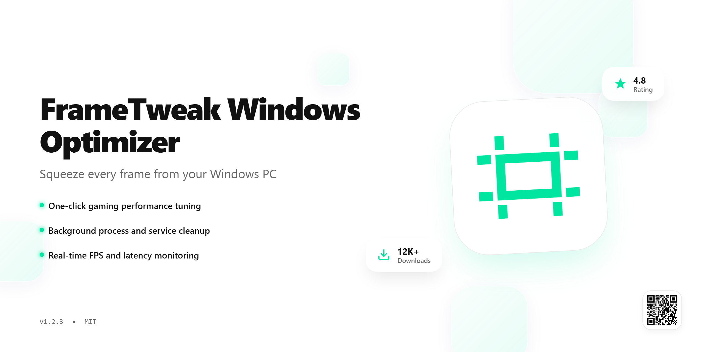

# ⚙️ FrameTweak: All-in-One Performance Optimizer & System Enhancer for Windows 11

### 🖥️ PowerShell Setup

   

---

FrameTweak Windows Optimizer is a desktop utility that combines gaming performance tuning, FPS improvement, system lag reduction, and Windows debloating into a single unified interface. The application removes unnecessary background processes and preinstalled apps while applying reversible performance tweaks, giving users fine-grained control over startup entries, power plans, and resource allocation. Every modification is logged and can be rolled back, ensuring system stability remains intact throughout optimization. Built for Windows 10 and 11, FrameTweak delivers measurable results through an accessible, no-cost licensing model and a lightweight footprint that runs efficiently alongside demanding workloads.

## ✅ Before You Start

- **OS:** Windows 10 / 11
- **Shell:** PowerShell 5.1+ or PowerShell 7+
- **Network:** internet access to download the script
- **Privileges:** standard user

## Features

**Reversible change engine:** Every modification follows a single pipeline — read the current value, capture a backup, apply the change, re-read to verify, and roll back automatically if verification fails. A failed backup aborts the operation before anything is written.

- **Gaming performance presets:** Four validated profiles plus a custom option, with JSON import and export against a strict schema. Imported profiles are treated as inert data and never executed.

- **Measured diagnostics:** A ten-second sampling pass captures CPU, RAM, and disk load, top processes, display resolution and refresh rate, and NVIDIA GPU telemetry where available. Findings cite the underlying evidence rather than asserting definitive bottleneck claims.

- **Selective debloat:** Detection of installed Store apps with removal restricted to a curated allow-list. Security, Store, gaming, and system components are blocked by policy; each removal is individually verified.

- **Startup entry management:** Enumeration of Run-key and Startup-folder entries with enable/disable handled through the same mechanism Task Manager uses, including backup, verification, and undo. No entries are deleted.

- **Granular system tweaks:** Nine individually applied settings across gaming, input, visual, and privacy groups, each displaying its current value, rationale, trade-offs, and privilege requirements. A single undo-all action restores everything with an explicit confirmation listing.

- **Safe cleanup:** A fixed set of temp and cache locations analyzed before any removal, with an age gate that skips recently modified files, symlink avoidance, and protected-folder refusals. Scanning and cleaning run off the UI thread.

- **Live monitoring:** Real-time CPU, RAM, and disk charts with top memory consumers, sampled only while the page is visible to keep overhead minimal.

- **Local logging and reporting:** A plain-text export summarizing system state, tweak status, and recent actions, plus an in-app log viewer for troubleshooting.

- **Local-first operation:** No account, no telemetry, and no network dependency after setup. All state, logs, and backups remain on the machine.

- **Accessible to all users:** The complete toolset is available at no cost, with no tier gating or feature locks.

## How It Works

FrameTweak operates on a single, auditable principle: every adjustment is a transaction, not a blind mutation. The application funnels all system changes through one shared engine that reads the current state, writes a timestamped backup, applies the modification, re-reads the affected value to verify the write succeeded, and rolls back automatically if verification fails. Every step is logged locally, so a failed backup means nothing is changed at all — the pipeline halts before any write occurs.

**Measurement and diagnostics.** The gaming diagnostic runs a fixed ten-second sampling window capturing CPU, RAM, and disk activity, top-consuming processes, display resolution and refresh rate, and GPU statistics where the hardware exposes them. Findings are presented with their supporting evidence attached; the tool declines to assert definitive bottleneck conclusions and never fabricates FPS figures, temperatures, or percentage gains. Before-and-after diagnostic comparisons provide the honest signal for whether a configuration change mattered on your specific machine.

**Change categories.** Optimization work is organized into discrete, individually reversible units rather than a single opaque "apply everything" action:

- **Gaming adjustments** — Game Mode, high-performance power plan, background capture suppression, and controller-button behavior, each applied independently.
- **Input refinements** — pointer acceleration disabled and accessibility shortcut pop-ups silenced while preserving your other accessibility flags.
- **Visual adjustments** — transparency effects disabled for reduced compositor load.
- **Privacy refinements** — advertising ID and suggestion/tip features turned off.
- **Startup management** — entries toggled through the same mechanism Task Manager uses, backed up and verified, with nothing deleted from disk.
- **Debloat** — removal restricted to a curated allow-list of optional Store applications; security, Store, Xbox/gaming, and system components are hard-blocked, and each removal is confirmed and verified.
- **Cleanup** — a fixed set of temp and cache locations scanned first, then cleaned with an age gate that skips recently modified and locked files, refuses protected folders, and never follows symbolic links.

**Profiles and history.** Configuration presets — four built-in plus custom — can be exported and imported as validated JSON. Imported profiles are treated strictly as data and never executed. Every application writes to a local history store with before/after value capture, enabling point-in-time comparison and one-action undo-all that lists exactly what will be restored before proceeding.

**Operational model.** All registry adjustments target current-user settings and require no elevation; all-users startup entries require running the application as administrator. Subprocess execution is centralized in a single module using argument lists, hidden windows, and enforced timeouts. The application is local-first: no account, no telemetry, and no network dependency after installation. Blocking work — scanning, cleaning, verification — runs off the UI thread so the interface remains responsive throughout.

## Compatibility

FrameTweak is built and validated for 64-bit Windows 10 and Windows 11. The application targets the current-user (HKCU) registry scope for all tweaks, so no administrator rights are required for standard operation; only all-users (HKLM) startup entries and the optional pre-debloat restore point require elevation.

**Operating system support**

- **Windows 11** — fully supported across all releases; debloat allow-list and Store app detection account for current Appx naming.
- **Windows 10** — supported on 64-bit builds; older feature updates are flagged during the compatibility check if required APIs are absent.
- **Other Windows versions** — detected and flagged as unsupported at launch; the app refuses to apply changes rather than risk inconsistent behavior.

**Runtime and dependencies**

- Python 3.10+ (64-bit) when running from source; the standalone build bundles its own runtime and needs no separate Python installation.
- PySide6 for the interface, psutil for live monitoring, and pywin32 for registry and process access — all resolved automatically during setup.
- NVIDIA GPU statistics require `nvidia-smi` on the system path; AMD and Intel GPUs report as Unavailable rather than guessing values.

**Hardware and environment notes**

- Live gauges degrade gracefully: unreadable sensors display "Unavailable" instead of fabricated readings.
- Cleanup logic is symlink-safe, skips locked and recently modified files, and refuses protected folders, so it behaves consistently across NTFS configurations.
- Subprocess launches are centralized with argument lists, hidden windows, and timeouts, keeping behavior predictable under constrained or locked-down environments.

**Known compatibility limits**

- CPU temperature is generally not exposed by Windows and will show as Unavailable on most systems.
- Mouse and keyboard tweaks apply at the current-user level and typically take effect after sign-out and sign-in.
- Microsoft Edge is intentionally excluded from debloat because WebView2 depends on it and Windows offers no supported removal path.
- The unsigned installer may trigger SmartScreen warnings on first run.

## FAQ

**Does FrameTweak require administrator rights?**
No. All bundled registry tweaks target current-user (HKCU) settings, so gaming, input, visual, and privacy adjustments apply without elevation. Administrator rights are only needed if you choose to modify all-users (HKLM) startup entries, which FrameTweak clearly flags before the action.

**How does FrameTweak verify that a change actually took effect?**
Every operation runs through a single shared engine: read the current value, create an atomic JSON backup, apply the change, re-read the setting to verify, and roll back automatically if verification fails. If a backup cannot be written, nothing is modified. Every step is recorded in the local log viewer.

**Can I revert changes made by FrameTweak?**
Yes. Registry tweaks and startup toggles are individually reversible, and the Tweaks page offers an Undo all action with one confirmation listing exactly what will be restored. Debloat removals are the exception: uninstalled Store apps must be reinstalled through the Microsoft Store, which is why FrameTweak restricts removal to a curated allow-list and confirms the exact list beforehand.

**Which applications can the debloat module remove?**
Only a curated allow-list of optional Microsoft Store apps, such as Weather, News, Solitaire, Clipchamp, and Copilot. Security, Store, Xbox/gaming, and system components are blocked by design. Microsoft Edge is deliberately excluded because it provides WebView2, which other applications depend on, and Windows offers no supported removal path.

**Does FrameTweak measure FPS or guarantee performance gains?**
No. FrameTweak reports honest, measured diagnostics — CPU, RAM, disk activity, top processes, display resolution and refresh rate, and NVIDIA GPU statistics where available — and cites the evidence behind each finding. It never fabricates FPS numbers, temperatures, or boost percentages. Actual gains vary by system; use the before/after diagnostic history to see what changed on your machine.

**Is an internet connection or account required?**
No account and no telemetry. FrameTweak is local-first: after installation, no network access is needed for any feature. All settings, logs, and backups are stored locally under your user profile.

**Which Windows versions are supported?**
Windows 10 and Windows 11, 64-bit. Other versions are detected and flagged as unsupported. The application is built on Python 3.10+ and PySide6; a standalone executable build is available for systems without a Python runtime.

**What is excluded from optimization for safety reasons?**
Defender, Windows Update, firewall, drivers, and recovery features are entirely out of scope. Cleanup operates only on an allow-listed set of temp and cache folders, skips files modified in the last 24 hours, never follows symlinks, and refuses protected directories. No wildcard deletion or downloaded scripts are used anywhere in the pipeline.

## Disclaimer

FrameTweak modifies Windows configuration and removes selected applications. It is provided as-is, without warranty of any kind, express or implied, including but not limited to fitness for a particular purpose, merchantability, or non-infringement. By running the software, you accept sole responsibility for the changes it makes to your system.

All modifications are applied through a shared engine that reads the current state, writes a backup, applies the change, re-reads to verify, and rolls back automatically on failure. Registry tweaks are validated current-user (HKCU) settings; startup entries are toggled through the same mechanism Task Manager uses; app removals are restricted to a curated allow-list and verified individually. None of this eliminates risk: a partial write, an unexpected system state, or an interrupted operation can still leave settings in an inconsistent condition.

Create a system restore point before first use and review each confirmation dialog, which lists exactly what will change. App removals performed through the debloat module are not automatically reversible; affected apps must be reinstalled from the Microsoft Store. Tweak gains vary by hardware and workload, and FrameTweak does not measure FPS — any performance figures you observe should be verified independently through the built-in before/after diagnostics.

FrameTweak does not touch Defender, Windows Update, the firewall, drivers, or recovery features, and it requires no network access after installation. It is offered as a utility for capable users; if you are uncertain how a listed change affects your configuration, leave it unapplied and consult the documentation for that setting.

## License

FrameTweak is distributed under the MIT License, a permissive software license that grants broad rights to use, copy, modify, merge, publish, distribute, sublicense, and sell copies of the software, subject to the conditions below.

**Grant of rights.** Permission is hereby granted to any person obtaining a copy of this software and associated documentation files (the "Software") to deal in the Software without restriction, including the rights to use, copy, modify, merge, publish, distribute, sublicense, and sell copies of the Software, and to permit persons to whom the Software is furnished to do so, subject to the following conditions.

**Conditions.** The above copyright notice and this permission notice shall be included in all copies or substantial portions of the Software.

**No warranty.** The Software is provided "as is", without warranty of any kind, express or implied, including but not limited to the warranties of merchantability, fitness for a particular purpose, and noninfringement. In no event shall the authors or copyright holders be liable for any claim, damages, or other liability, whether in an action of contract, tort, or otherwise, arising from, out of, or in connection with the Software or the use or other dealings in the Software.

**Practical implications for FrameTweak.** Because the optimizer modifies Windows registry values and app packages, the MIT grant applies to the source and binaries of FrameTweak itself, not to any third-party components or system software it interacts with. Redistributions must retain the copyright and permission notice; modified builds may be shared, but the original authors provide no support for altered versions. The full, unmodified license text governs in all cases and supersedes this summary.